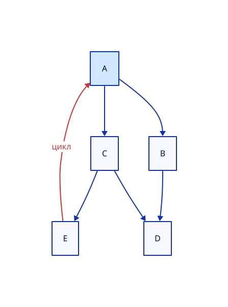
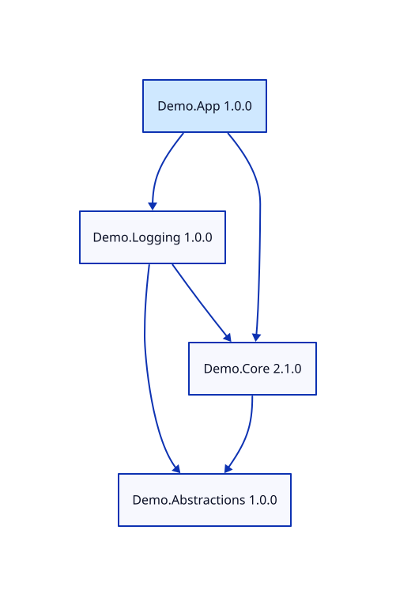
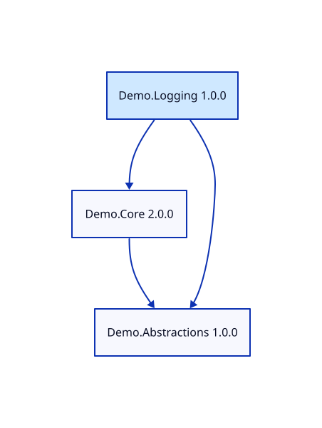
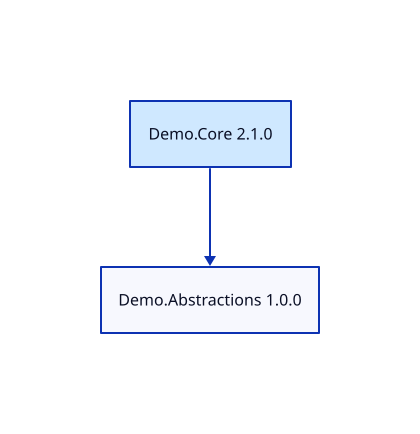
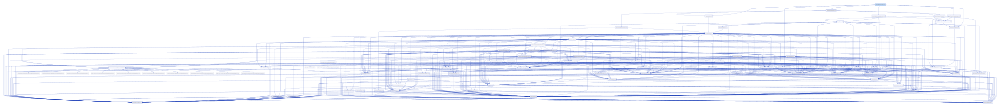
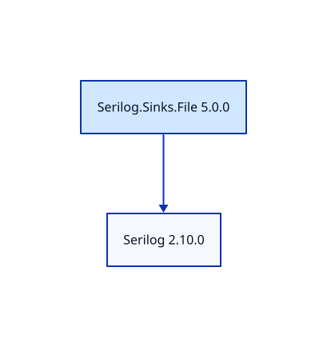
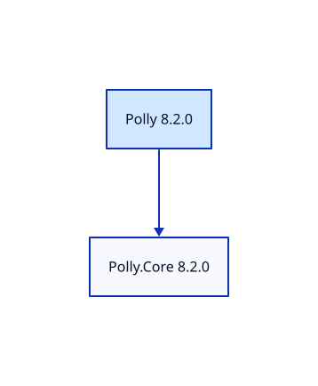

# depviz — граф зависимостей пакетов NuGet

## 1. Общее описание

`depviz` — консольный инструмент визуализации графа зависимостей для
менеджера пакетов **NuGet** (.NET). Он читает информацию о пакетах
напрямую из репозитория NuGet (формат flat container), строит граф
зависимостей с учётом транзитивности, выводит порядок загрузки
пакетов, формирует описание графа на языке диаграмм **D2** и сохраняет
изображение графа в файле **SVG**.

Менеджеры пакетов и сторонние библиотеки для получения зависимостей
**не используются**: HTTP-запросы выполняет стандартный `urllib`, XML
разбирается стандартным `xml.etree`, конфигурация читается стандартным
`tomllib`. Проект написан на Python 3.11+ и не имеет внешних
зависимостей; для получения SVG из текста D2 нужна программа `d2`
(CLI языка D2, https://d2lang.com).

Практическая работа выполнена в пять этапов. Каждый этап — отдельный
коммит с тегом, поэтому вывод любого этапа можно воспроизвести командой
`git checkout stage-N`:

| Этап | Тег       | Что делает программа                                            |
|------|-----------|-----------------------------------------------------------------|
| 1    | `stage-1` | Читает TOML-конфигурацию, проверяет её, выводит параметры       |
| 2    | `stage-2` | Получает и выводит прямые зависимости пакета из репозитория     |
| 3    | `stage-3` | Строит граф рекурсивным DFS, обрабатывает циклы, тестовый режим |
| 4    | `stage-4` | Выводит порядок загрузки зависимостей                           |
| 5    | `stage-5` | Формирует D2, сохраняет SVG (итоговая версия)                   |

Вывод, который по заданию нужен «только для этого этапа» (параметры на
этапе 1, прямые зависимости на этапе 2), в итоговой версии заменён;
вывод графа (этап 3) и порядка загрузки (этап 4) доступен в итоговой
версии ключами `--graph` и `--order`.

## 2. Описание всех функций и настроек

### 2.1. Конфигурационный файл (TOML)

Источник настраиваемых параметров — TOML-файл, путь к которому
передаётся первым аргументом командной строки (по умолчанию
`config.toml`). Должны быть заданы все параметры; неизвестные
параметры считаются ошибкой. Относительные пути отсчитываются от
текущего каталога.

| Параметр          | Тип    | Описание                                                       |
|-------------------|--------|----------------------------------------------------------------|
| `package_name`    | строка | Имя анализируемого пакета                                      |
| `package_version` | строка | Версия пакета (`13.0.3`, `1.0.0-beta.1`)                       |
| `repository`      | строка | URL репозитория (`remote`) или путь к файлу графа (`test`)     |
| `repository_mode` | строка | `remote` — репозиторий NuGet, `test` — тестовый файл           |
| `output_file`     | строка | Имя файла с изображением графа, расширение `.svg`              |
| `max_depth`       | число  | Максимальная глубина анализа зависимостей, от 1 до 100         |

Пример (`examples/config.toml`):

```toml
package_name = "Newtonsoft.Json"
package_version = "13.0.3"
repository = "https://api.nuget.org/v3-flatcontainer/"
repository_mode = "remote"
output_file = "output/newtonsoft-json.svg"
max_depth = 3
```

### 2.2. Командная строка

```text
python -m depviz [config] [--graph] [--order]
```

* `config` — путь к TOML-файлу (по умолчанию `config.toml`);
* `--graph` — дополнительно вывести граф списком смежности и найденные
  циклы (вывод этапа 3);
* `--order` — дополнительно вывести порядок загрузки зависимостей
  (вывод этапа 4).

Без ключей программа строит граф, печатает его описание на D2,
сохраняет файл `.d2` рядом с изображением и создаёт SVG.

### 2.3. Обработка ошибок

Каждый параметр проверяется при запуске. Сообщение об ошибке выводится
в `stderr`, коды возврата:

| Код | Причина                                                            |
|-----|--------------------------------------------------------------------|
| `0` | успешное выполнение                                                |
| `2` | ошибка конфигурации                                                |
| `3` | ошибка репозитория (пакет не найден, сеть, неверный файл графа)     |
| `4` | ошибка визуализации (`d2` не найдена или завершилась с ошибкой)    |

Проверки конфигурации:

* наличие и синтаксис файла; наличие всех параметров, отсутствие
  неизвестных;
* типы значений: строки не пустые, `max_depth` — целое число
  (значение `true` целым не считается);
* `package_name`: в режиме `remote` — латиница, цифры, `.`, `_`, `-`;
  в режиме `test` — только большие латинские буквы;
* `package_version` — формат версии NuGet/SemVer;
* `repository`: http(s)-URL в режиме `remote`, существующий файл в
  режиме `test`;
* `repository_mode` — только `remote` или `test`;
* `output_file` — расширение `.svg`, не каталог;
* `max_depth` — от 1 до 100.

### 2.4. Сбор данных (этап 2)

Источник данных — flat container репозитория NuGet. Для пакета `Id`
версии `X` читается файл `{repository}/{id}/{X}/{id}.nuspec`
(идентификатор и версия приводятся к нижнему регистру, версия
нормализуется: `1.0` → `1.0.0`). `.nuspec` — XML-файл (любое
пространство имён); из него извлекаются все элементы `dependency`.

* Если зависимости разбиты на группы по целевым платформам
  (`targetFramework`), берётся одна группа — самой современной
  платформы: `net5.0` и новее, затем `netcoreapp`, затем
  `netstandard`, затем остальные (`.NETFramework` и др.). Так NuGet
  выбирает одну группу под платформу проекта. Повторы (без учёта
  регистра) отбрасываются.
* Версия зависимости задаётся диапазоном NuGet. Список опубликованных
  версий читается из `{repository}/{id}/index.json`; выбирается
  минимальная доступная версия, удовлетворяющая границам диапазона.
  Например, для `(1.0.0, 2.0.0]` версия `1.0.0` исключается, а для
  `[4.1.0]` требуется ровно `4.1.0`. Если подходящей версии нет,
  программа сообщает об ошибке.
* Запросы выполняются с таймаутом 20 с; списки версий кэшируются в
  пределах обработки одного пакета.

### 2.5. Граф зависимостей (этап 3)

Граф строится **рекурсивным обходом в глубину (DFS)**. Корень лежит на
глубине 0; пакеты на глубине `max_depth` попадают в граф, но их
зависимости уже не анализируются (в выводе они помечены).

* **Глубина.** Если пакет сначала найден на пределе глубины, а позже —
  по более короткому пути, он обходится заново (иначе часть графа
  потерялась бы). Каждый повторный обход идёт по строго меньшей
  глубине, поэтому обход всегда конечен.
* **Циклы.** Пока пакет находится на текущем пути рекурсии, повторная
  встреча с ним означает цикл: ребро добавляется в граф, но рекурсия в
  него не заходит. Циклы (включая зависимость пакета от самого себя)
  фиксируются и выводятся списком.
* **Имена** пакетов сравниваются без учёта регистра, как в NuGet.
* **Версии.** Если пакет встретился с разными версиями, в графе
  остаётся версия, найденная первой.

### 2.6. Тестовый режим

При `repository_mode = "test"` вместо URL в `repository` указывается
путь к текстовому файлу, описывающему граф репозитория; пакеты в нём
называются большими латинскими буквами. Версия в этом режиме
игнорируется.

Формат файла: одна строка на пакет, `A: B C` (зависимости через пробел
или запятую). Пустые строки и всё после `#` пропускаются. Пакет,
упомянутый только как зависимость, не имеет собственных зависимостей.
Ошибки формата сообщаются с номером строки.

### 2.7. Порядок загрузки (этап 4)

Порядок загрузки — такой порядок пакетов, при котором каждый пакет
стоит **после** всех своих зависимостей, а запрошенный пакет —
последний. Он получается обходом графа в глубину с добавлением
вершины в список после обработки всех её зависимостей (post-order).
Каждый пакет входит в список один раз. В графе с циклом такого порядка
не существует; ребро, замыкающее цикл, игнорируется.

### 2.8. Визуализация (этап 5)

* Текст графа формируется на языке D2: вершины `n0`, `n1`, … с
  подписями «имя версия» (подписи, а не имена, — потому что точка в
  ключе D2 означала бы вложенность), рёбра `A -> B` означают «A
  зависит от B».
* Корневой пакет закрашен, пакеты на пределе глубины нарисованы
  пунктиром, ребро, замыкающее цикл, красное и подписано «цикл».
* Текст D2 печатается на экран и сохраняется в файл рядом с
  изображением (`output_file` с расширением `.d2`).
* Изображение строится командой `d2 файл.d2 файл.svg`; необходимые
  каталоги создаются автоматически.

### 2.9. Структура репозитория

```text
src/depviz/      исходный код (config, nuget, repository, graph,
                 order, report, d2, cli)
tests/           модульные тесты (unittest)
examples/        примеры конфигураций, тестовые репозитории,
                 локальный демонстрационный репозиторий NuGet
Makefile, run.sh, run.bat   запуск и тесты
```

## 3. Сборка, запуск и тесты

Сборка не требуется. Нужны Python 3.11 или новее и (для SVG) программа
`d2` в `PATH` (установка: https://d2lang.com/tour/install).

```bash
make run CONFIG=examples/config.toml     # Linux/macOS
./run.sh examples/config.toml            # Linux/macOS
run.bat examples\config.toml --order     # Windows (ключи передаются дальше)
make test                                # запуск тестов
```

Эквивалент без Makefile:

```bash
PYTHONPATH=src python3 -m depviz examples/config.toml --graph --order
PYTHONPATH=src python3 -m unittest discover -s tests -t . -v
```

Для работы без интернета в `examples/mock_nuget` лежит небольшой
репозиторий в формате flat container; раздать его можно локальным
сервером:

```bash
python3 -m http.server 8765 --directory examples/mock_nuget
```

## 4. Примеры использования

### 4.1. Этап 1: параметры и обработка ошибок (`git checkout stage-1`)

```text
$ ./run.sh examples/config.toml
package_name = 'Newtonsoft.Json'
package_version = '13.0.3'
repository = 'https://api.nuget.org/v3-flatcontainer/'
repository_mode = 'remote'
output_file = 'output/newtonsoft-json.svg'
max_depth = 3
```

Обработка ошибок (слева — испорченный параметр, ниже — сообщение):

```text
./run.sh nope.toml
Ошибка конфигурации: файл конфигурации не найден: nope.toml

package_name = ""
Ошибка конфигурации: параметр package_name не должен быть пустым

max_depth = 0
Ошибка конфигурации: max_depth должен быть от 1 до 100, получено 0

repository = "ftp://x"
Ошибка конфигурации: repository 'ftp://x' не является URL http(s)

output_file = "g.png"
Ошибка конфигурации: output_file 'g.png' должен иметь расширение .svg
```

### 4.2. Этап 2: прямые зависимости (`git checkout stage-2`)

Демонстрация на локальном репозитории (запущен `http.server`, см.
раздел 3). Диапазон `[1.0.0, 2.0.0)` у `Demo.Logging` превращён в
`1.0.0`:

```text
$ ./run.sh examples/config_mock.toml
Прямые зависимости пакета Demo.App 1.0.0:
  Demo.Core 2.1.0
  Demo.Logging 1.0.0
```

Пакет отсутствует в репозитории и сервер недоступен:

```
Ошибка репозитория: пакет Nope 1.0.0 не получен из
  http://127.0.0.1:8765/nope/1.0.0/nope.nuspec (HTTP 404)
Ошибка репозитория: ошибка доступа к
  http://127.0.0.1:9/a/1.0.0/a.nuspec:
  <urlopen error [Errno 111] Connection refused>
```

С реальным репозиторием: `./run.sh examples/config.toml` (нужен
доступ в интернет).

### 4.3. Этап 3: граф и тестовый режим (`git checkout stage-3`)

Файл `examples/test_repo.txt` (в нём есть цикл `A -> C -> E -> A`):

```text
A: B C
B: D
C: D E
D:
E: A
```

Глубина 1:

```text
Граф зависимостей пакета A (максимальная глубина 1):
  A -> B, C
  B (глубина анализа исчерпана)
  C (глубина анализа исчерпана)
Циклические зависимости:
  не обнаружены
```

Глубина 2:

```text
Граф зависимостей пакета A (максимальная глубина 2):
  A -> B, C
  B -> D
  D (глубина анализа исчерпана)
  C -> D, E
  E (глубина анализа исчерпана)
Циклические зависимости:
  не обнаружены
```

Глубина 3 (цикл найден, обход завершён):

```text
Граф зависимостей пакета A (максимальная глубина 3):
  A -> B, C
  B -> D
  D (нет зависимостей)
  C -> D, E
  E -> A
Циклические зависимости:
  A -> C -> E -> A
```

Файл `examples/test_repo_cycles.txt` (цикл `B -> C -> B` и зависимость
пакета `D` от самого себя):

```text
A: B
B: C D
C: B
D: D E
E:
```

```text
$ ./run.sh examples/config_test_cycles.toml
Граф зависимостей пакета A (максимальная глубина 10):
  A -> B
  B -> C, D
  C -> B
  D -> D, E
  E (нет зависимостей)
Циклические зависимости:
  B -> C -> B
  D -> D
```

Пакет, которого нет в тестовом репозитории (`package_name = "Z"`):

```text
Ошибка репозитория: пакет Z не найден в тестовом репозитории
```

Граф на локальном демонстрационном репозитории NuGet. `Demo.Logging`
запрашивает `Demo.Core` версии `2.0.0`, но в графе остаётся версия
`2.1.0`, найденная первой:

```text
$ ./run.sh examples/config_mock.toml
Граф зависимостей пакета Demo.App 1.0.0 (максимальная глубина 3):
  Demo.App 1.0.0 -> Demo.Core 2.1.0, Demo.Logging 1.0.0
  Demo.Core 2.1.0 -> Demo.Abstractions 1.0.0
  Demo.Abstractions 1.0.0 (нет зависимостей)
  Demo.Logging 1.0.0 -> Demo.Abstractions 1.0.0, Demo.Core 2.1.0
Циклические зависимости:
  не обнаружены
```

### 4.4. Этап 4: порядок загрузки (`git checkout stage-4`)

Тестовый репозиторий `examples/test_repo.txt`, глубина 3:

```text
$ ./run.sh examples/config_test.toml
Порядок загрузки зависимостей пакета A:
  1. D
  2. B
  3. E
  4. C
  5. A
```

Глубина 1 (только прямые зависимости):

```text
Порядок загрузки зависимостей пакета A:
  1. B
  2. C
  3. A
```

Репозиторий с циклами:

```text
$ ./run.sh examples/config_test_cycles.toml
Порядок загрузки зависимостей пакета A:
  1. C
  2. E
  3. D
  4. B
  5. A
```

Локальный репозиторий NuGet:

```text
$ ./run.sh examples/config_mock.toml
Порядок загрузки зависимостей пакета Demo.App 1.0.0:
  1. Demo.Abstractions 1.0.0
  2. Demo.Core 2.1.0
  3. Demo.Logging 1.0.0
  4. Demo.App 1.0.0
```

#### Сравнение с реальным менеджером пакетов

Чтобы сравнить результат с NuGet, нужно получить порядок
установки пакетов менеджером и сопоставить с выводом `depviz --order`
для того же пакета и версии (например, `Microsoft.Extensions.Logging
8.0.0`, `examples/config_nuget_logging.toml`):

```bash
nuget install Microsoft.Extensions.Logging -Version 8.0.0 \
    -OutputDirectory packages -NoCache
dotnet new console -o compare && cd compare
dotnet add package Microsoft.Extensions.Logging --version 8.0.0
dotnet list package --include-transitive
```
Результат сравнения для `Microsoft.Extensions.Logging 8.0.0` (проект
под `net10.0`, .NET SDK 10.0.401). Команда `dotnet list package
--include-transitive` показала пять транзитивных пакетов:

```text
Пакет верхнего уровня               Запрошено   Разрешено
> Microsoft.Extensions.Logging      8.0.0       8.0.0

Транзитивный пакет                                           Разрешено
> Microsoft.Extensions.DependencyInjection                   8.0.0
> Microsoft.Extensions.DependencyInjection.Abstractions      8.0.0
> Microsoft.Extensions.Logging.Abstractions                  8.0.0
> Microsoft.Extensions.Options                               8.0.0
> Microsoft.Extensions.Primitives                            8.0.0
```

Набор пакетов и их версии полностью совпали с результатом `depviz`.
Порядок загрузки `depviz --order`:

```text
1. Microsoft.Extensions.DependencyInjection.Abstractions 8.0.0
2. Microsoft.Extensions.DependencyInjection 8.0.0
3. Microsoft.Extensions.Logging.Abstractions 8.0.0
4. Microsoft.Extensions.Primitives 8.0.0
5. Microsoft.Extensions.Options 8.0.0
6. Microsoft.Extensions.Logging 8.0.0
```

Каждый пакет стоит после всех своих зависимостей. Порядок установки в
логе `dotnet add package` другой (Primitives, DependencyInjection,
DependencyInjection.Abstractions, Logging, Options,
Logging.Abstractions): NuGet скачивает пакеты параллельно, и `Logging`
оказался раньше своих зависимостей. Это допустимое расхождение, так
как порядок не единственный (см. пункт 1 ниже).

Возможные причины расхождений:

1. **Порядок не единственный.** У пакетов, не зависящих друг от друга,
   допустимо несколько порядков. `depviz` выдаёт детерминированный
   (зависимости обходятся в порядке их перечисления в `.nuspec`),
   `dotnet restore` скачивает пакеты параллельно. Сравнивать нужно
   отношение «зависимость раньше зависимого», а не позиции пакетов.
2. **Целевая платформа.** NuGet выбирает группу под платформу проекта,
   `depviz` всегда берёт группу самой современной платформы. Если
   проект ориентирован на другую платформу, набор пакетов будет
   отличаться.
3. **Выбор версии.** `depviz` выбирает минимальную опубликованную
   версию, удовлетворяющую диапазону каждой зависимости. NuGet при
   восстановлении разрешает ограничения сразу по всем путям графа и
   может выбрать другую итоговую версию пакета.
4. **Глубина.** `max_depth` ограничивает анализ, у NuGet такого
   ограничения нет.
5. **Атрибуты зависимостей.** NuGet учитывает `include` и `exclude`
   у зависимостей, `depviz` — нет.

### 4.5. Этап 5: D2 и SVG (итоговая версия)

Три различных пакета локального репозитория (`Demo.App`,
`Demo.Logging`, `Demo.Core`); при запуске `d2` создаёт SVG
(`output/*.svg`).

`Demo.App 1.0.0` (`examples/config_mock.toml`):

```text
Граф в формате D2 (файл output/demo.d2):
direction: down
n0: "Demo.App 1.0.0" {
  style.fill: "#cfe8ff"
}
n1: "Demo.Core 2.1.0"
n2: "Demo.Abstractions 1.0.0"
n3: "Demo.Logging 1.0.0"
n0 -> n1
n0 -> n3
n1 -> n2
n3 -> n2
n3 -> n1
Изображение графа сохранено: output/demo.svg
```

`Demo.Logging 1.0.0` (`examples/config_mock_logging.toml`):

```text
Граф в формате D2 (файл output/demo-logging.d2):
direction: down
n0: "Demo.Logging 1.0.0" {
  style.fill: "#cfe8ff"
}
n1: "Demo.Abstractions 1.0.0"
n2: "Demo.Core 2.0.0"
n0 -> n1
n0 -> n2
n2 -> n1
Изображение графа сохранено: output/demo-logging.svg
```

`Demo.Core 2.1.0` (`examples/config_mock_core.toml`):

```text
Граф в формате D2 (файл output/demo-core.d2):
direction: down
n0: "Demo.Core 2.1.0" {
  style.fill: "#cfe8ff"
}
n1: "Demo.Abstractions 1.0.0"
n0 -> n1
Изображение графа сохранено: output/demo-core.svg
```

Тестовый репозиторий с циклами (ребро `C -> B` красное и подписано
«цикл», так же `D -> D`):

```text
Граф в формате D2 (файл output/test-cycles.d2):
direction: down
n0: "A" {
  style.fill: "#cfe8ff"
}
n1: "B"
n2: "C"
n3: "D"
n4: "E"
n0 -> n1
n1 -> n2
n1 -> n3
n2 -> n1: "цикл" {
  style.stroke: "#cc3333"
  style.font-color: "#cc3333"
}
n3 -> n3: "цикл" {
  style.stroke: "#cc3333"
  style.font-color: "#cc3333"
}
n3 -> n4
Изображение графа сохранено: output/test-cycles.svg
```

Все ключи вместе (`--graph --order`):

```text
$ ./run.sh examples/config_mock_logging.toml --graph --order
Граф зависимостей пакета Demo.Logging 1.0.0 (максимальная глубина 3):
  Demo.Logging 1.0.0 -> Demo.Abstractions 1.0.0, Demo.Core 2.0.0
  Demo.Abstractions 1.0.0 (нет зависимостей)
  Demo.Core 2.0.0 -> Demo.Abstractions 1.0.0
Циклические зависимости:
  не обнаружены
Порядок загрузки зависимостей пакета Demo.Logging 1.0.0:
  1. Demo.Abstractions 1.0.0
  2. Demo.Core 2.0.0
  3. Demo.Logging 1.0.0
Граф в формате D2 (файл output/demo-logging.d2):
direction: down
n0: "Demo.Logging 1.0.0" {
  style.fill: "#cfe8ff"
}
n1: "Demo.Abstractions 1.0.0"
n2: "Demo.Core 2.0.0"
n0 -> n1
n0 -> n2
n2 -> n1
Изображение графа сохранено: output/demo-logging.svg
```

Примеры конфигураций для реального репозитория nuget.org:
`examples/config_nuget_logging.toml` (`Microsoft.Extensions.Logging
8.0.0`), `examples/config_nuget_serilog.toml` (`Serilog.Sinks.File
5.0.0`), `examples/config_nuget_polly.toml` (`Polly 8.2.0`).

Тестовый репозиторий с циклом:



Локальный репозиторий NuGet:







Реальные пакеты с nuget.org:






#### Сравнение со штатными инструментами визуализации

Штатные средства NuGet показывают зависимости так:

* `dotnet list package --include-transitive` — плоский список прямых и
  транзитивных пакетов проекта (без рёбер);
* страница пакета на nuget.org, вкладка Dependencies — зависимости,
  сгруппированные по целевым платформам;
* Visual Studio, узел Dependencies → Packages — дерево пакетов проекта.

Для `Microsoft.Extensions.Logging 8.0.0` штатная команда `dotnet list
package --include-transitive` (вывод приведён в разделе 4.4) даёт плоский
список из шести пакетов, а `depviz` рисует те же шесть пакетов графом
(см. картинку выше). По составу и версиям результаты совпадают, но
список не показывает, кто от кого зависит: например, что
`DependencyInjection.Abstractions` нужен сразу трём пакетам.

Расхождения с `depviz`, которые нужно учитывать:

1. **Форма представления.** Штатные средства дают список или дерево,
   `depviz` — ориентированный граф: общая зависимость (ромб) нарисована
   одной вершиной с несколькими входящими рёбрами, а не повторяется в
   каждой ветке дерева.
2. **Платформы.** Штатные средства показывают зависимости платформы
   проекта (или отдельные группы на nuget.org), `depviz` показывает
   группу самой современной платформы.
3. **Версии.** В итоговом дереве NuGet — единственная версия каждого
   пакета, выбранная с учётом ограничений по всем путям графа; `depviz`
   разрешает каждый диапазон отдельно и сохраняет первую найденную
   версию пакета, поэтому при конфликте версий результаты могут отличаться.
4. **Глубина и циклы.** `max_depth` обрезает граф (обрезанные вершины
   пунктиром), а циклы `depviz` отмечает явно.
5. **Состав.** Пакеты, исключённые атрибутами `exclude`/`include` или
   подставляемые SDK, штатные средства учитывают, `depviz` — нет.
